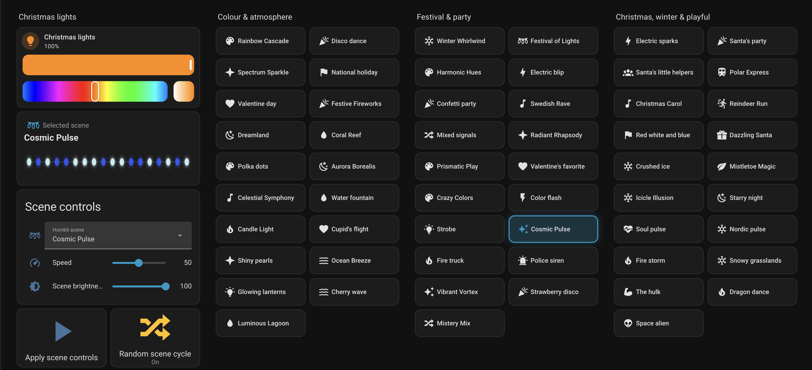

# Hombli Christmas Lights for Home Assistant

Local, cloud-free Home Assistant control and a Lovelace dashboard for the
**Hombli Smart Christmas Lights RGB** controller. These Tuya-powered smart
Christmas string/fairy lights are controlled through LocalTuya and the supplied
Home Assistant Marketplace custom integration, with all 57 built-in RGB scenes/effects, scene speed,
scene brightness, active-scene highlighting, and an animated LED preview.
The dashboard also includes a start/stop control that automatically selects a
different random scene every 30 seconds.

The captured datapoint and scene map can also serve as a reference when adapting
related Tuya RGB string lights, smart fairy lights, or Christmas-tree lights for
local Home Assistant control.

## Source device and project origin

This project was developed and tested with the
[Hombli Smart Christmas Light RGB](https://hombli.com/collections/ambiance/products/hombli-smart-christmas-light-rgb):
a 20-metre, Wi-Fi-connected string with 200 individually zoned RGBIC LEDs.

The datapoint assignments, all 57 scene names and DP25 codes, control behaviour,
and animated dashboard preview were captured from this physical controller. We
observed the Hombli app and LocalTuya traffic, tested each effect on the lights,
and recorded the real LED animations to build the preview. This is therefore a
tested configuration for that product—not a generic mapping assumed from other
Tuya lights.

> [!IMPORTANT]
> This is a device-specific community project. The DP assignments and scene
> codes were captured from one Hombli/Tuya controller using LocalTuya protocol
> 3.3. Verify the datapoints on your own hardware before writing values.

This project is not affiliated with Hombli, Tuya, Home Assistant, LocalTuya, or
the Button Card project.

> [!NOTE]
> Version 2 and later use the Marketplace custom integration. If you previously used
> the YAML package from version 1, remove it before adding the integration; see
> [Migrating from the legacy package](#migrating-from-the-legacy-package).

## Dashboard preview



The supplied Sections dashboard combines the light controls, current-scene
preview, speed and scene-brightness controls, and all 57 scene buttons in one
wide-screen view.

## Compatibility at a glance

| Item | This project |
|---|---|
| Product | [Hombli Smart Christmas Light RGB](https://hombli.com/collections/ambiance/products/hombli-smart-christmas-light-rgb) |
| Device family | Tuya Wi-Fi RGB smart string/fairy lights |
| Home Assistant integration | LocalTuya, local network control |
| Dashboard | Lovelace Sections view with Button Card |
| Effects | 57 captured Hombli/Tuya scenes on DP25 |
| Extra controls | Power, animation speed and scene brightness |

## What is included

- Exact DP25 codes for 57 named scenes from the Hombli app
- Power, scene mode, speed and scene-brightness control
- A Home Assistant custom integration prepared for Marketplace distribution
- A four-column Sections dashboard example
- Compact scene buttons with active-scene highlighting
- A start/stop random scene cycle that chooses a different effect every 30 seconds
- An 18-light animated preview calibrated from a full recording of the physical
  light string

## Confirmed datapoints

| DP | Purpose | Values used here |
|---:|---|---|
| 20 | Power | `true` / `false` |
| 21 | Work mode | `scene` |
| 25 | Built-in scene | Four-character scene code, e.g. `0006` |
| 103 | Animation speed | Integer `1`–`100` |
| 105 | Scene brightness | Integer `1`–`100` |

See [Compatibility and safety](docs/COMPATIBILITY.md) before installing.

## Requirements

- Home Assistant with Marketplace installed
- [LocalTuya](https://github.com/rospogrigio/localtuya) configured for the light controller
- [Button Card](https://github.com/custom-cards/button-card) installed for the
  supplied dashboard and animated preview
- A Home Assistant light entity for the controller, provided by LocalTuya or
  the standard Tuya integration
- The Tuya/Hombli device ID and local key obtained through your usual LocalTuya
  setup process

## Installation

### 1. Confirm and configure the device

Do not start by sending the scene codes. First verify that your controller uses
the same datapoints listed above. Read [docs/COMPATIBILITY.md](docs/COMPATIBILITY.md).

Configure the controller in LocalTuya before adding this integration. The
integration deliberately reuses LocalTuya's local connection and does not ask
for or store the Tuya local key.

### 2. Install through Home Assistant Marketplace

1. Open **Marketplace → Integrations**.
2. Search for **Hombli Christmas Lights**.
3. Install the integration.
4. Restart Home Assistant.

### 3. Add the integration

1. Open **Settings → Devices & services**.
2. Select **Add integration** and search for **Hombli Christmas Lights**.
3. Enter a display name and the exact device ID already used by LocalTuya.

The device ID is stored in the Home Assistant config entry and is redacted from
downloaded diagnostics. The local key remains exclusively in LocalTuya.

### 4. Install the dashboard view

The supplied example is a [Sections view](https://www.home-assistant.io/dashboards/sections/).
Open the target dashboard view in raw configuration mode and paste the contents
of:

```text
dashboards/sections-view.yaml
```

If your light entity is not
`light.hombli_smart_christmas_lights_rgb`, replace that entity ID in the
dashboard file. If Home Assistant assigned different entity IDs to the new
integration, replace the example `hombli_christmas_lights_*` IDs as well.

## Migrating from the legacy package

If you used a pre-2.0 release, migrate once instead of running both versions:

1. Remove or rename `/config/packages/christmas_lights.yaml`.
2. Restart Home Assistant so its old helpers, scripts and automations disappear.
3. Install and add the Marketplace integration using the steps above.
4. Replace the old dashboard view with `dashboards/sections-view.yaml`.
5. Remove any remaining dashboard references to the old
   `input_select`, `input_number`, `input_boolean` and `script` entities.

LocalTuya and its light entity remain in place; the migration does not require
re-pairing or changing the controller's local key.

## Entities created by the Marketplace integration

| Entity | Purpose |
|---|---|
| `select.hombli_christmas_lights_scene` | Sends and displays the last successfully commanded scene |
| `number.hombli_christmas_lights_animation_speed` | Immediate DP103 speed control |
| `number.hombli_christmas_lights_scene_brightness` | Immediate DP105 scene-brightness control |
| `button.hombli_christmas_lights_random_scene` | Selects one random scene |
| `switch.hombli_christmas_lights_random_scene_cycle` | Selects a different random scene every 30 seconds |

Entity IDs can receive a numeric suffix if an entity with the same name already
exists. Use the IDs shown on the integration's device page in that case.

## How the dashboard state works

Each scene button calls `select.select_option`. The active button is highlighted
from the integration's Scene entity, which changes only after LocalTuya accepts
the command.

The **Random scene cycle** button changes to a different random scene
immediately and then every 30 seconds. Press it again to stop. The selected
speed and scene-brightness values remain unchanged while scenes cycle.

Turning the matching LocalTuya or Tuya light off also stops the random cycle
immediately. The cycle will not turn the string back on at its next scheduled
interval.

The controller exposes the selected scene code but not its live per-LED frames.
The animated preview therefore replays a recording-derived approximation. It
shows the correct scene-specific grouping, colours, dark states and movement,
and changes to static grey bulbs while the light is off.
but is not phase-locked to the physical string.

## Scene map

The complete captured scene-to-DP25 table is in [docs/SCENES.md](docs/SCENES.md).

## Adapting this for a related controller

1. Confirm your DP mapping in LocalTuya diagnostics.
2. Fork the repository; do not overwrite the verified map immediately.
3. Test power and work mode first.
4. Test one scene code at low brightness.
5. Capture the values reported while selecting scenes in the vendor app.
6. Update `SCENE_CODES` in
   `custom_components/hombli_christmas_lights/const.py`.
7. Record the physical effects and update the dashboard preview mapping where
   your controller differs.

Please contribute confirmed mappings with the device model, firmware version,
protocol version and evidence. See [CONTRIBUTING.md](CONTRIBUTING.md).

## Limitations

- App-originated scene changes do not update the Scene entity automatically.
- Scene, speed and scene brightness are assumed state: they represent the last
  successful command sent by this integration, not live per-DP feedback.
- The preview is illustrative, not a live LED feed.
- Power monitoring was not found on the tested controller; separate support
  work has been submitted to the PowerCalc project.
- DP assignments can differ across Tuya products and firmware versions.
- The supplied dashboard depends on Button Card.

## Troubleshooting

See [docs/TROUBLESHOOTING.md](docs/TROUBLESHOOTING.md) for LocalTuya errors,
unknown entities/actions, missing cards, inactive highlights and safe rollback.

## License

Configuration and documentation in this repository are released under the
[MIT License](LICENSE). Vendor names and trademarks belong to their respective
owners.
